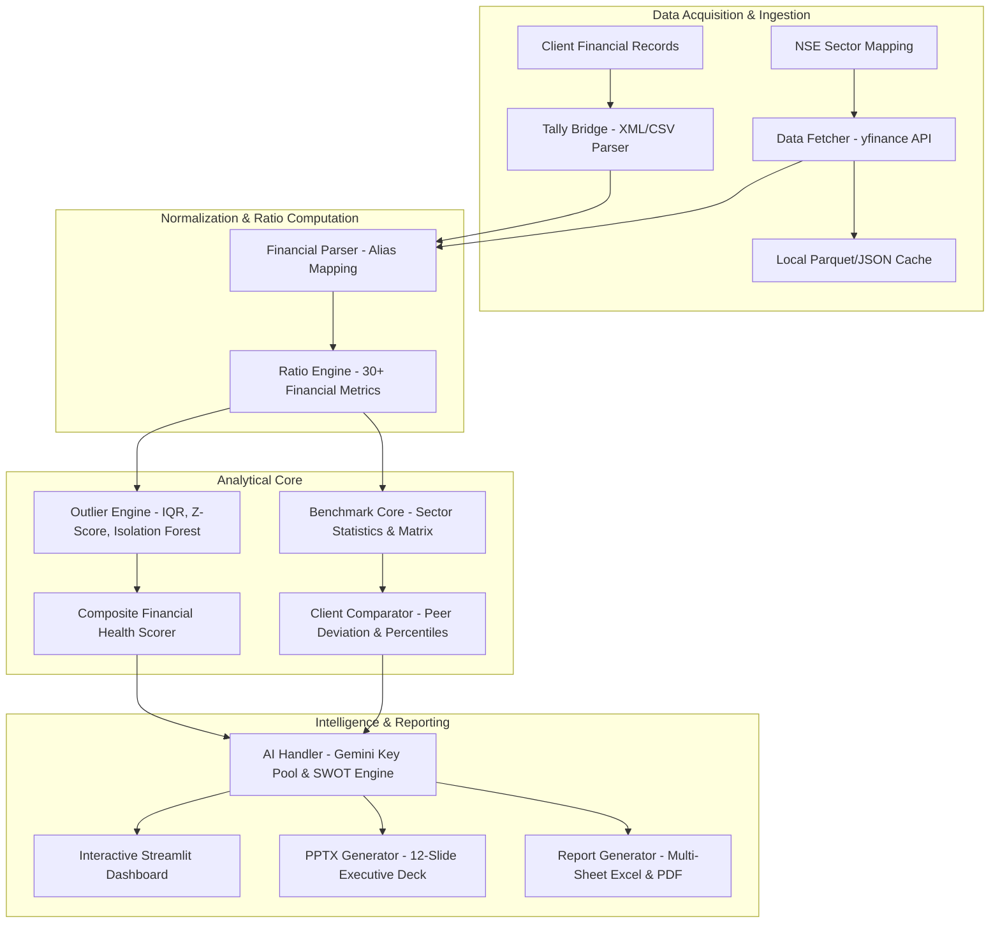
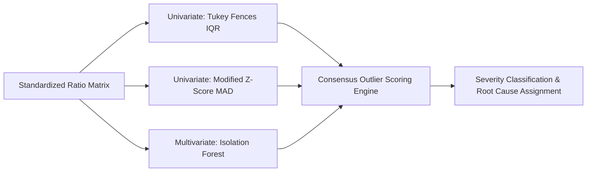

# FinMetrics Suite Pvt: Cross-Sectional Financial Outlier Detection and Client Benchmarking System

An enterprise-grade cross-sectional financial intelligence platform for National Stock Exchange (NSE) listed equities and private client corporate entities. The system integrates automated financial statement acquisition, multi-method anomaly detection, 5-pillar composite solvency scoring, Tally ERP 9/Prime trial balance parsing, and automated executive PowerPoint/PDF briefing synthesis.

---

## 1. System Architecture



---

## 2. Directory Structure and Component Mapping

```
finmetrics-suite-pvt/
|-- app.py                         # Streamlit multi-tab enterprise dashboard entry point
|-- generate_pdf.py                # Standalone technical & executive PDF compiler
|-- requirements.txt               # Production Python dependency specification
|-- .env.example                   # Environment configuration template
|-- .gitignore                     # Git security and cache exclusion rules
|-- README.md                      # Primary architectural blueprint and specification
|-- SYSTEM_LOGICS_AND_BLUEPRINT.md # Mathematical and algorithmic blueprint
|-- USER_MANUAL.md                 # End-user operational guide
|-- USER_MANUAL.docx               # Formatted Word manual documentation
|-- NSE_Outlier_Detective_Overview.pdf # Executive slide deck overview
|
|-- modules/                       # Core analytical and presentation engines
|   |-- __init__.py                # Package initialization
|   |-- ai_handler.py              # Multi-key Gemini API management & narrative synthesis
|   |-- benchmark_classifier.py    # Company size, lifecycle, and model classification
|   |-- benchmark_core.py          # Sector statistical matrix & distribution modeling
|   |-- benchmark_store.py         # Disk persistence and caching for benchmark runs
|   |-- client_comparator.py       # Client-vs-peer deviation, gap, and percentile engine
|   |-- data_fetcher.py            # yfinance API pipeline with TTL caching & retry logic
|   |-- financial_parser.py        # Statement standardization, schema aliasing, sign handling
|   |-- outlier_engine.py          # IQR, Modified Z-Score, and Isolation Forest algorithms
|   |-- pptx_charts.py             # Native python-pptx vector charting implementations
|   |-- pptx_components.py         # UI cards, callout containers, scorecards, tables
|   |-- pptx_design_tokens.py      # Typography, palette, padding, and layout geometries
|   |-- pptx_generator.py          # Master PowerPoint presentation compiler
|   |-- pptx_slides.py             # 12 standardized slide layout templates
|   |-- ratio_engine.py            # 30+ cross-sectional financial ratio calculators
|   |-- report_generator.py        # Multi-tab styled openpyxl Excel & insight generation
|   |-- sector_loader.py           # NSE sector and industry ticker catalogs
|   |-- tally_bridge.py            # Tally XML/CSV parser, account mapping, and trial balance
|   |-- utils.py                   # Math routines, logging framework, and formatting
|   `-- visualization.py           # Plotly interactive figures & Abyss Teal styling
|
|-- client/                        # Client-specific sample data and trial balances
|-- data/                          # Benchmark cache storage and database targets
|-- docs/                          # In-depth architectural and mathematical manuals
|   |-- 01_overview_architecture.md
|   |-- 02_ratios_and_outliers.md
|   |-- 03_benchmarking_and_scoring.md
|   `-- 04_visuals_and_conclusion.md
`-- Report/                        # Academic & technical LaTeX report source and PDF
```

---

## 3. Core Analytical Methodologies

### 3.1 Financial Ratio Taxonomy

The system computes over 30 standardized financial metrics organized into seven analytical categories:

| Category | Computed Metrics | Core Formulas |
| :--- | :--- | :--- |
| **Liquidity** | Current Ratio, Quick Ratio, Cash Ratio | `Current Assets / Current Liabilities`<br>`(Cash + Marketable Securities + Receivables) / Current Liabilities` |
| **Solvency & Leverage** | Debt to Equity, Debt to Assets, Interest Coverage | `Total Debt / Total Equity`<br>`EBIT / Interest Expense` |
| **Profitability** | Gross Margin, Operating Margin, Net Margin, ROE, ROA, ROCE | `Operating Income / Revenue`<br>`Net Income / Average Equity`<br>`EBIT / Capital Employed` |
| **Operational Efficiency** | Asset Turnover, Inventory Turnover, DSO, Cash Conversion Cycle | `Revenue / Total Assets`<br>`COGS / Average Inventory`<br>`DIO + DSO - DPO` |
| **Cash Flow Health** | Operating Cash Flow Ratio, Free Cash Flow Margin, Cash Flow to Debt | `CFO / Current Liabilities`<br>`(CFO - CapEx) / Revenue` |
| **Growth Metrics** | Revenue CAGR, EBITDA Growth, EPS Growth | `(Value_t / Value_{t-1}) - 1` |
| **Valuation** | Price to Earnings (P/E), Price to Book (P/B), EV/EBITDA | `Market Price / EPS`<br>`Enterprise Value / EBITDA` |

---

### 3.2 Outlier Detection Framework

The platform deploys a three-tier statistical and machine learning anomaly detection pipeline:



1. **Tukey Fences (Interquartile Range - IQR)**:
   $$\text{IQR} = Q_3 - Q_1$$
   $$\text{Lower Fence} = Q_1 - k \cdot \text{IQR}, \quad \text{Upper Fence} = Q_3 + k \cdot \text{IQR} \quad (k = 1.5)$$

2. **Modified Z-Score (Median Absolute Deviation - MAD)**:
   $$M_i = \frac{0.6745 \cdot (x_i - \tilde{x})}{\text{MAD}}$$
   $$\text{MAD} = \text{median}(|x_i - \tilde{x}|)$$
   Anomalies flagged when $|M_i| > 2.5$.

3. **Isolation Forest (Multivariate Anomaly Detection)**:
   Constructs an ensemble of isolation trees to partition high-dimensional ratio space. Outliers are identified by short average path lengths:
   $$s(x, n) = 2^{-\frac{E(h(x))}{c(n)}}$$

---

### 3.3 Composite Financial Health Scoring Model

Entities are evaluated across five weighted operational pillars (0 to 100 scale):

$$\text{Composite Score} = \sum_{j=1}^{5} w_j \cdot P_j$$

| Pillar ($P_j$) | Weight ($w_j$) | Evaluated Key Performance Indicators |
| :--- | :---: | :--- |
| **Profitability** | 30% | Operating Margin, Net Margin, ROE, ROCE |
| **Solvency** | 20% | Debt/Equity, Interest Coverage, Debt/Assets |
| **Growth** | 20% | 3-Year Revenue CAGR, EBITDA Expansion |
| **Liquidity** | 15% | Current Ratio, Quick Ratio, Cash Ratio |
| **Efficiency** | 15% | Asset Turnover, Inventory Turnover, DSO |

#### Health Classification Tiers
- **80 - 100**: Low Risk / Prime
- **65 - 79**: Moderate Risk / Stable
- **50 - 64**: Neutral / Average
- **35 - 49**: Vulnerable / Sub-Optimal
- **0 - 34**: High Risk / Distressed

---

## 4. Tally ERP 9 / Prime Integration & Client Benchmarking

The platform features an automated ingestion bridge for private client data:

1. **Trial Balance Parsing**: Ingests raw XML exports or CSV dumps from Tally ERP.
2. **Account Classification**: Normalizes custom chart of accounts into standardized financial statement categories.
3. **Comparative Analysis**: Compares private client metrics directly against NSE sector medians, quartiles, and peer distributions.
4. **Gap Identification**: Pinpoints specific areas where client performance deviates significantly from industry standards.

---

## 5. Multi-Key Gemini AI Synthesis

The platform features an AI Handler supporting dynamic API key pooling:
- **Key Rotation**: Cycles across multiple Gemini API keys to distribute quota and avoid rate limits.
- **Model Discovery**: Dynamically resolves the highest performance available Gemini model.
- **SWOT Analysis**: Generates corporate Strengths, Weaknesses, Opportunities, and Threats based on ratio deviations.
- **Executive Summaries**: Produces audit-ready natural language commentary for corporate presentations.

---

## 6. Installation and Execution

### Prerequisites
- Python 3.10, 3.11, 3.12, or 3.13
- Git

### Installation Steps

```bash
# 1. Clone the repository
git clone https://github.com/<your-username>/finmetrics-suite-pvt.git
cd finmetrics-suite-pvt

# 2. Set up virtual environment (recommended)
python -m venv .venv
# Windows:
.venv\Scripts\activate
# Linux/macOS:
source .venv/bin/activate

# 3. Install required packages
pip install -r requirements.txt

# 4. Configure environment keys
cp .env.example .env
# Edit .env and supply your GEMINI_API_KEY
```

### Launching the Application

```bash
# Start the Streamlit Dashboard
streamlit run app.py
```

The application will be accessible at `http://localhost:8501`.

---

## 7. Technology Stack

- **Frontend & Interface**: Streamlit
- **Visualization**: Plotly Graph Objects, Seaborn, Matplotlib
- **Analytical & Statistical Engine**: NumPy, Pandas, SciPy, Scikit-Learn, Statsmodels
- **Market Data Pipeline**: yfinance, Requests, Python-Dateutil
- **Document & Presentation Generation**: python-pptx, openpyxl, xlsxwriter, fpdf2
- **Artificial Intelligence**: Google GenAI SDK (Gemini API)
- **Data Formats**: Apache Parquet, SQLite, JSON, XML, CSV

---

## 8. License and Operational Disclaimer

This system is designed for institutional analysis, academic research, and corporate benchmarking. Financial ratio outputs and automated AI narratives represent algorithmic statistical computations and should be verified against official audited corporate disclosures prior to commercial investment decisions.
