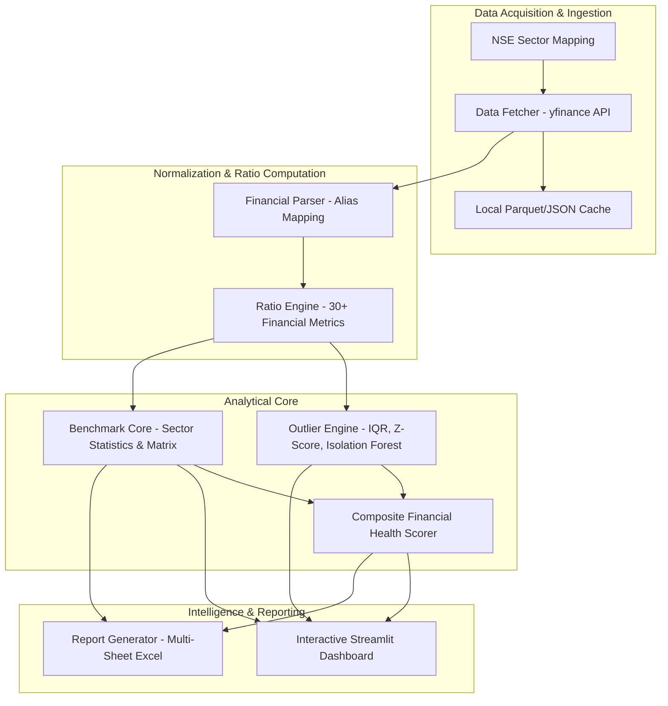

# FinMetrics: Cross-Sectional Financial Outlier Detection and Sector Benchmarking System

An enterprise-grade cross-sectional financial intelligence platform for National Stock Exchange (NSE) listed equities. The system integrates automated financial statement acquisition, multi-method anomaly detection (IQR, Modified Z-score, Isolation Forest), 5-pillar composite solvency and health scoring, sector benchmark matrices, and automated executive Excel reporting.

---

## 1. System Architecture



---

## 2. Directory Structure and Component Mapping

```
finmetrics/
|-- app.py                         # Streamlit multi-tab enterprise dashboard entry point
|-- requirements.txt               # Production Python dependency specification
|-- .env.example                   # Environment configuration template
|-- .gitignore                     # Git security and cache exclusion rules
|-- README.md                      # Primary architectural specification
|-- SYSTEM_LOGICS_AND_BLUEPRINT.md # Mathematical and algorithmic blueprint
|-- USER_MANUAL.md                 # End-user operational guide
|
|-- modules/                       # Core analytical and presentation engines
|   |-- __init__.py                # Package initialization
|   |-- ai_handler.py              # Multi-key Gemini API management & ticker discovery
|   |-- benchmark_classifier.py    # Company size, lifecycle, and model classification
|   |-- benchmark_core.py          # Sector statistical matrix & distribution modeling
|   |-- benchmark_store.py         # Disk persistence and caching for benchmark runs
|   |-- data_fetcher.py            # yfinance API pipeline with TTL caching & retry logic
|   |-- financial_parser.py        # Statement standardization, schema aliasing, sign handling
|   |-- outlier_engine.py          # IQR, Modified Z-Score, and Isolation Forest algorithms
|   |-- ratio_engine.py            # 30+ cross-sectional financial ratio calculators
|   |-- report_generator.py        # Multi-sheet Excel export & statistical explanations
|   |-- sector_loader.py           # NSE sector and industry ticker catalogs
|   |-- utils.py                   # Math routines, logging framework, and formatting
|   `-- visualization.py           # Plotly interactive figures & Abyss Teal styling
|
|-- data/                          # Benchmark cache storage and database targets
|-- tests/                         # Pytest unit and integration test suite
`-- blueprints/                    # System architecture blueprints and code audit specs
```

---

## 3. Core Analytical Methodologies

### 3.1 Financial Ratio Taxonomy

The system computes over 30 standardized financial metrics organized into seven analytical categories:

| Category | Computed Metrics | Core Formulas |
| :--- | :--- | :--- |
| **Liquidity** | Current Ratio, Quick Ratio, Cash Ratio | `Current Assets / Current Liabilities`<br>`(Cash + Marketable Securities + Receivables) / Current Liabilities` |
| **Solvency & Leverage** | Debt to Equity, Debt to Assets, Interest Coverage | `Total Debt / Total Equity`<br>`EBIT / Interest Expense` |
| **Profitability** | Gross Margin, Operating Margin, Net Margin, ROE, ROA, ROCE | `Operating Income / Revenue`<br>`Net Income / Average Equity`<br>`EBIT / Capital Employed` |
| **Operating Efficiency** | Asset Turnover, Inventory Turnover, Receivables Turnover | `Revenue / Total Assets`<br>`COGS / Inventory`<br>`Revenue / Accounts Receivable` |
| **Cash Flow Health** | Operating Cash Flow Ratio, Free Cash Flow Margin, Cash Conversion Ratio | `Operating Cash Flow / Current Liabilities`<br>`FCF / Revenue`<br>`Operating Cash Flow / Net Income` |
| **Growth Potential** | Revenue Growth, Net Income Growth, Operating Cash Flow Growth | `(Metric_t - Metric_t-1) / Metric_t-1` |
| **Per Share & Valuation** | EPS, Book Value Per Share, Price to Free Cash Flow | `Net Income / Shares Outstanding`<br>`Equity / Shares Outstanding` |

---

### 3.2 Outlier Detection Framework

The Outlier Engine deploys three distinct, complementary detection models:

1. **Interquartile Range (IQR) Fencing**: Identifies values falling outside `[Q1 - 1.5*IQR, Q3 + 1.5*IQR]`.
2. **Modified Z-Score (Median Absolute Deviation - MAD)**: Robust standardization flagging observations where `|M_i| > 3.5`.
3. **Isolation Forest (Multivariate Anomaly Scoring)**: Unsupervised ensemble tree model detecting multidimensional structural anomalies across the ratio feature space.

---

### 3.3 Composite Solvency & Financial Health Scoring

Companies are evaluated on an objective 0–100 scale across five financial pillars:

| Pillar | Default Weight | Key Ratio Components |
| :--- | :--- | :--- |
| **Profitability** | 25% | Operating Margin, Net Margin, ROE, ROCE |
| **Solvency & Leverage**| 25% | Debt to Equity, Interest Coverage, Debt Ratio |
| **Liquidity** | 20% | Current Ratio, Quick Ratio, Cash Ratio |
| **Cash Flow** | 15% | Operating Cash Flow Ratio, FCF Margin |
| **Efficiency** | 15% | Asset Turnover, Inventory Turnover, DSO |

#### Health Classification Tiers
- **80 - 100**: Low Risk / Prime
- **65 - 79**: Moderate Risk / Stable
- **50 - 64**: Neutral / Average
- **35 - 49**: Vulnerable / Sub-Optimal
- **0 - 34**: High Risk / Distressed

---

## 4. Multi-Key Gemini AI Handler

The platform includes an AI Handler supporting dynamic API key pooling:
- **Key Rotation**: Cycles across multiple Gemini API keys to distribute quota and avoid rate limits.
- **Model Discovery**: Dynamically resolves the highest performance available Gemini model.
- **Industry Discovery**: Performs intelligent ticker searching and categorization for custom peer groups.

---

## 5. Installation and Execution

### Prerequisites
- Python 3.10, 3.11, 3.12, or 3.13
- Git

### Installation Steps

```bash
# 1. Clone the repository
git clone https://github.com/hi1r0/finmetrics.git
cd finmetrics

# 2. Set up virtual environment (recommended)
python -m venv .venv
# Windows:
.venv\Scripts\activate
# Linux/macOS:
source .venv/bin/activate

# 3. Install required packages
pip install -r requirements.txt

# 4. Configure environment keys
cp .env.example .env
# Edit .env and supply your GEMINI_API_KEY (optional)
```

### Launching the Application

```bash
# Start the Streamlit Dashboard
streamlit run app.py
```

The application will be accessible at `http://localhost:8501`.

---

## 6. Running Tests

```bash
python -m pytest
```

---

## 7. Technology Stack

- **Frontend & Interface**: Streamlit
- **Visualization**: Plotly Graph Objects, Seaborn, Matplotlib
- **Analytical & Statistical Engine**: NumPy, Pandas, SciPy, Scikit-Learn, Statsmodels
- **Market Data Pipeline**: yfinance, Requests, Python-Dateutil
- **Document & Reporting Generation**: xlsxwriter, openpyxl
- **Artificial Intelligence**: Google GenAI SDK (Gemini API)
- **Data Formats**: Apache Parquet, SQLite, JSON, CSV

---

## 8. License and Operational Disclaimer

This system is designed for institutional analysis, academic research, and corporate benchmarking. Financial ratio outputs represent algorithmic statistical computations and should be verified against official audited corporate disclosures prior to commercial investment decisions.
