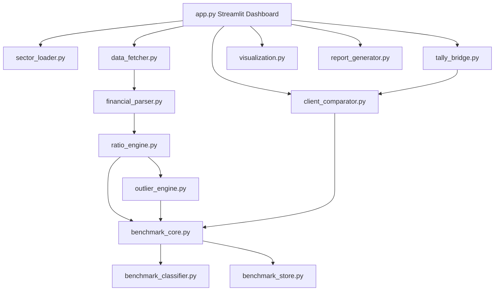
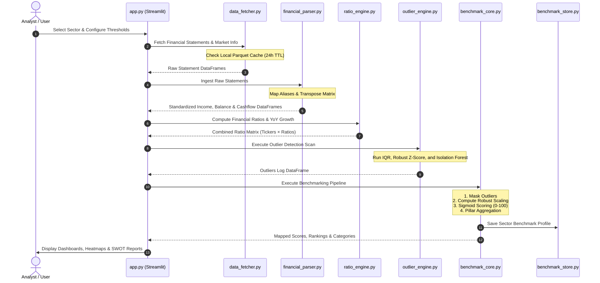
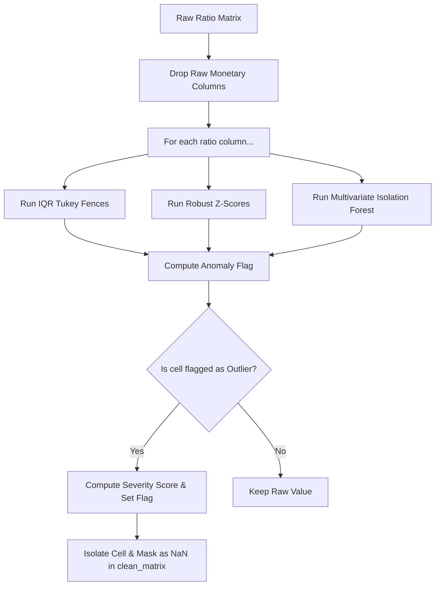
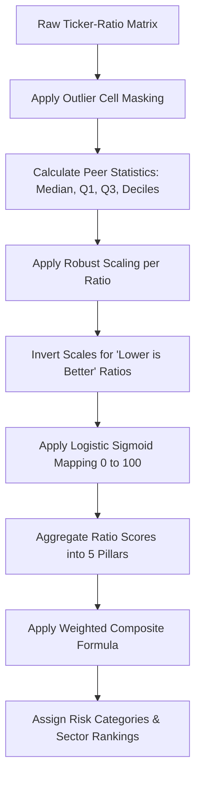
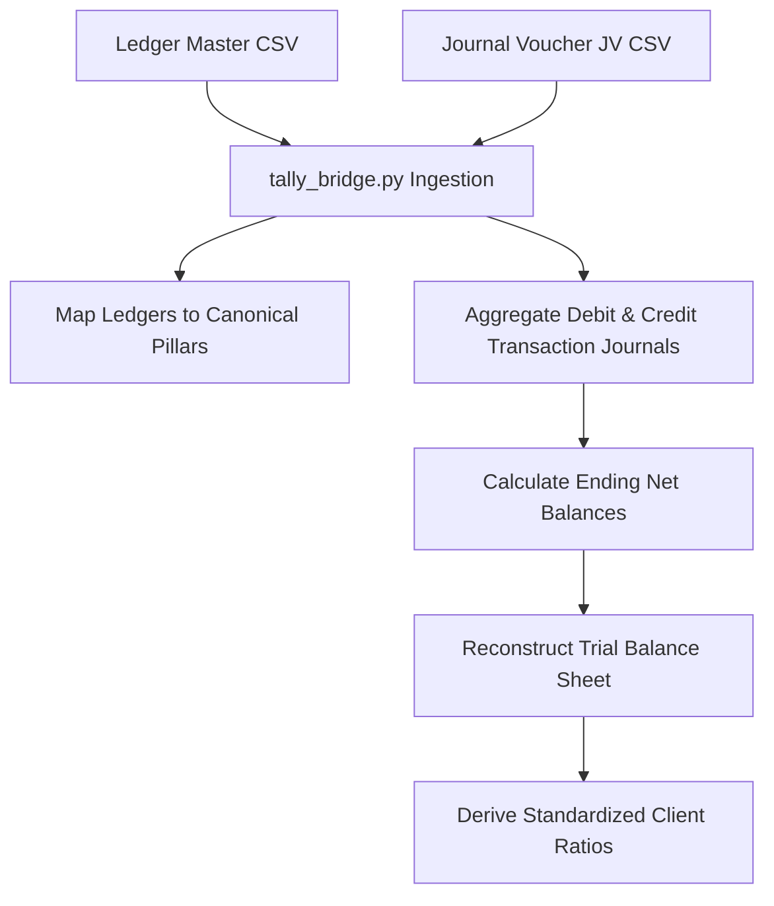
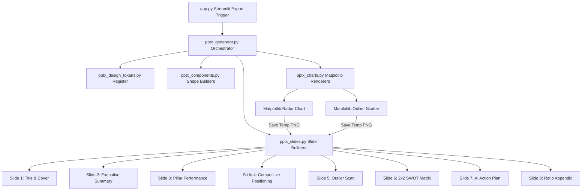

#  NSE Financial Outlier Detection & Benchmarking System
## Technical Blueprint, Architectural Logic, and Mathematical Foundation

### Table of Contents
1. [Introduction & System Purpose](#1-introduction--system-purpose)
2. [Module Architecture & Global System Flowcharts](#2-module-architecture--global-system-flowcharts)
3. [Data Ingestion & Normalization Engine (yfinance)](#3-data-fetching--normalization-engine-yfinance)
4. [Ratio Calculation Engine](#4-ratio-engine--computational-logic)
5. [Statistical Outlier Detection Engine](#5-statistical-outlier-detection-engine)
6. [Benchmarking Scoring Pipeline](#6-benchmarking-scoring-pipeline)
7. [Client Comparator & Tally Bridge Ingestion](#7-client-comparator--tally-bridge-ingestion)
8. [PowerPoint (PPTX) Executive Briefing Engine (Temporarily Disabled)](#8-powerpoint-pptx-executive-briefing-engine-temporarily-disabled)
9. [SWOT Classification & Strategic Insight Generation](#9-swot-classification--strategic-insight-generation)
10. [Operational Boundaries, Error Handling & Limitations](#10-operational-boundaries-error-handling--limitations)

---

## 1. Introduction & System Purpose

The **NSE Financial Outlier Detection & Benchmarking System** is a robust Python-based quantitative finance platform designed to automate cross-sectional financial analysis, statistical anomaly detection, and strategic benchmarking for companies listed on the National Stock Exchange of India (NSE) as well as private clients. 

### 1.1 Core Problems Solved
1. **Parsing Friction**: Financial statements retrieved from raw APIs (like Yahoo Finance) are highly inconsistent, with changing line-item descriptions and shifted timeframes. The system automates ingestion and standardizes reports in under 60 seconds.
2. **Distribution Skewness**: Extreme financial metrics (e.g., a P/E ratio of $5000\times$ or interest coverage of $-400\times$) drag arithmetic averages and standard deviations, rendering normal companies indistinguishable under traditional z-score models. The system addresses this with robust median-based scaling and cell-level outlier masking.
3. **Black-Box Metrics**: Most quantitative models return a health score without auditability. The system generates a detailed **Contribution Matrix** and translates mathematical comparisons into plain-English **SWOT Narrative Reports** for executive consumption.
4. **Private-Public Gap**: Financial consultants struggle to compare non-public clients directly against listed peers. The system bridges this gap by parsing standard client spreadsheets or aggregating raw **Tally ERP Journal entries** to compute a standardized baseline comparison.

### 1.2 Target User Personas
*   **Equity Analysts**: Run cross-sectional sector scans to flag undervalued performers or identify companies with deteriorating fundamentals.
*   **Risk Officers**: Scan for extreme statistical outliers that could signify accounting anomalies, operational distress, or aggressive revenue recognition.
*   **Client Advisors & Consultants**: Map private clients directly against public sector baselines to build strategic SWOT matrices and comparative financial reports.

---

## 2. Module Architecture & Global System Flowcharts

The platform is designed around a modular pipeline pattern. Each step of the process is handled by a dedicated module with well-defined contracts, ensuring the data pipeline is reliable and easy to audit.

### 2.1 Module Architecture Flowchart


### 2.2 End-to-End Ingestion and Analysis Flowchart


### 2.3 Core Source Code Index
The codebase consists of the following components:

*   [app.py](file:///D:/Python/PYCHARM/PANDAS/app.py) — The Streamlit graphical entry point. Orchestrates session states, sidebar configuration, UI custom styling (Abyss Teal), and renders the 9 analytical tabs.
*   [modules/sector_loader.py](file:///D:/Python/PYCHARM/PANDAS/modules/sector_loader.py) — Contains structural mappings of NSE sectors (e.g., Automobile, IT, FMCG, Banking) to primary ticker symbols.
*   [modules/data_fetcher.py](file:///D:/Python/PYCHARM/PANDAS/modules/data_fetcher.py) — Collects data from Yahoo Finance (`yfinance`), manages the local caching database, and implements API rate-limiting delays.
*   [modules/financial_parser.py](file:///D:/Python/PYCHARM/PANDAS/modules/financial_parser.py) — Resolves field discrepancies across financial statement versions by mapping raw columns to canonical variables.
*   [modules/ratio_engine.py](file:///D:/Python/PYCHARM/PANDAS/modules/ratio_engine.py) — Computes 30+ quarterly and annual financial metrics with safeguards against division by zero.
*   [modules/outlier_engine.py](file:///D:/Python/PYCHARM/PANDAS/modules/outlier_engine.py) — Houses univariate statistical fences (IQR, Z-Score) and multivariate anomaly detection (Isolation Forest) algorithms.
*   [modules/benchmark_core.py](file:///D:/Python/PYCHARM/PANDAS/modules/benchmark_core.py) — Runs the  benchmarking engine, utilizing robust statistics to rank and score peer groups.
*   [modules/benchmark_classifier.py](file:///D:/Python/PYCHARM/PANDAS/modules/benchmark_classifier.py) — Determines percentile positions, health categorization labels, and signal classes for individual ratios.
*   [modules/benchmark_store.py](file:///D:/Python/PYCHARM/PANDAS/modules/benchmark_store.py) — Handles file persistence (Parquet/JSON) for finalized sector benchmarks.
*   [modules/client_comparator.py](file:///D:/Python/PYCHARM/PANDAS/modules/client_comparator.py) — Normalizes uploaded client files and maps ratios to compare them against saved benchmarks.
*   [modules/tally_bridge.py](file:///D:/Python/PYCHARM/PANDAS/modules/tally_bridge.py) — Ingests ledger structures and journal entries exported from Tally ERP to compute standardized client ratios.
*   [modules/ai_handler.py](file:///D:/Python/PYCHARM/PANDAS/modules/ai_handler.py) — Connects to the Google Gemini API, manages key rotation, and recommends target tickers for AI Search.
*   [modules/pptx_generator.py](file:///D:/Python/PYCHARM/PANDAS/modules/pptx_generator.py) — The orchestrating client for generating widescreen PowerPoint briefings from analysis data.
*   [modules/pptx_slides.py](file:///D:/Python/PYCHARM/PANDAS/modules/pptx_slides.py) — Renders the individual slide layout structures (Cover, Executive Summary, Scorecards, SWOT, Appendix, etc.).
*   [modules/pptx_charts.py](file:///D:/Python/PYCHARM/PANDAS/modules/pptx_charts.py) — Matplotlib-based slide-compatible chart generators (Radar, Scatter, bars) with a transparent dark canvas.
*   [modules/pptx_components.py](file:///D:/Python/PYCHARM/PANDAS/modules/pptx_components.py) — Renders shape-based widgets (Cards, KPI blocks, progress bars, tables) with exact coordinates.
*   [modules/pptx_design_tokens.py](file:///D:/Python/PYCHARM/PANDAS/modules/pptx_design_tokens.py) — Declares design colors, dimensions, font sizes, margins, and brand guidelines for the slides deck.
*   [modules/visualization.py](file:///D:/Python/PYCHARM/PANDAS/modules/visualization.py) — Renders interactive charts (radar, sunburst, stacked contribution bars, scatter plots, heatmaps) in Plotly and Seaborn.
*   [modules/report_generator.py](file:///D:/Python/PYCHARM/PANDAS/modules/report_generator.py) — Compiles outputs into multi-sheet Excel workbooks with proper styling and exports SWOT classifications.
*   [modules/utils.py](file:///D:/Python/PYCHARM/PANDAS/modules/utils.py) — Implements helpers like `safe_divide()`, exponential backoff decorators, logging config, and numeric converters.

---

## 3. Data Fetching & Normalization Engine (yfinance)

Raw financial filings retrieved via Yahoo Finance contain inconsistent naming conventions across companies, sectors, and historical quarters. The system standardizes this data using the **Parser & Normalization Ingestion pipeline**.

### 3.1 Fetching, Caching, and Retries
*   **Throttling Control**: To prevent Yahoo Finance API rate limits, a configurable time delay (default `0.5s`) is enforced between ticker queries.
*   **Retry Logic**: System API calls are wrapped in a custom `@retry` decorator (located in [utils.py](file:///D:/Python/PYCHARM/PANDAS/modules/utils.py#L54-L72)) implementing up to 3 execution attempts with exponential backoff delays ($Delay = Base \times Attempt$).
*   **Two-Tier Caching Database**:
    1.  **RAM Cache**: Streamlit's `@st.cache_data` caches raw operations locally during a session.
    2.  **File Cache**: Raw data is stored in localized Parquet files under `data/cache/` using MD5 hash naming conventions. The default Cache Time-To-Live (TTL) is set to 24 hours.

### 3.2 Parsing Ingestion Pipeline
1.  **DataFrame Transposition**: Converts the raw `yfinance` field-as-row, date-as-column configuration into a standard row-per-date structure.
2.  **Canonical Alias Resolution**: The engine sweeps raw column names against pre-defined alias sets. If a match is found, the column is renamed to its standardized key.
3.  **Deduplication**: Handles duplicate records that can arise from overlapping quarterly and annual statement ingestion.
4.  **Data Type Alignment**: Enforces a strict `float64` schema across all numeric fields and sorts indices chronologically.

### 3.3 Alias Mapping Configuration
The [financial_parser.py](file:///D:/Python/PYCHARM/PANDAS/modules/financial_parser.py) file maps over 60 naming variants to canonical fields. A summary of key mappings is provided below:

| Canonical Key | Financial Statement | Primary Naming Aliases Mapped |
|:---|:---|:---|
| `total_revenue` | Income Statement | "Total Revenue", "Revenue", "Net Revenue", "Net Sales", "Revenues" |
| `gross_profit` | Income Statement | "Gross Profit", "GrossProfit", "Gross Income" |
| `operating_income` | Income Statement | "Operating Income", "Operating Profit", "EBIT", "OperatingIncome" |
| `net_income` | Income Statement | "Net Income", "Net Profit", "NetIncome", "Net Profit After Tax" |
| `interest_expense` | Income Statement | "Interest Expense", "Interest Expense Paid", "Finance Costs" |
| `ebitda` | Income Statement | "EBITDA", "Normalized EBITDA", "Ebitda" |
| `depreciation_amortization` | Income Statement | "Depreciation & Amortization", "Depreciation And Amortization" |
| `total_assets` | Balance Sheet | "Total Assets", "TotalAssets", "Total Assets Mapped" |
| `total_liabilities` | Balance Sheet | "Total Liabilities", "Total Liabilities Mapped", "Total Liabilities Net Minor Interest" |
| `total_equity` | Balance Sheet | "Total Equity", "Stockholders Equity", "Shareholders Equity", "Net Worth" |
| `current_assets` | Balance Sheet | "Total Current Assets", "Current Assets", "CurrentAssets" |
| `current_liabilities` | Balance Sheet | "Total Current Liabilities", "Current Liabilities", "CurrentLiabilities" |
| `cash_and_equivalents` | Balance Sheet | "Cash And Cash Equivalents", "Cash Cash Equivalents And Short Term Investments", "Cash" |
| `inventory` | Balance Sheet | "Inventory", "Inventories", "Stock In Hand" |
| `accounts_receivable` | Balance Sheet | "Receivables", "Accounts Receivable", "Net Receivables", "Sundry Debtors" |
| `total_debt` | Balance Sheet | "Total Debt", "Long Term Debt + Short Term Debt", "Borrowings" |
| `operating_cashflow` | Cash Flow Statement | "Operating Cash Flow", "Cash Flow From Operating Activities", "Net Cash From Operating Activities" |
| `capital_expenditure` | Cash Flow Statement | "Capital Expenditure", "CapEx", "Purchase Of Property Plant And Equipment" |
| `free_cashflow` | Cash Flow Statement | "Free Cash Flow", "Free Cashflow" |

---

## 4. Ratio Engine & Computational Logic

The [ratio_engine.py](file:///D:/Python/PYCHARM/PANDAS/modules/ratio_engine.py) module extracts values from standardized statements and computes financial ratios.

### 4.1 Liquidity Ratios
Measure a company's ability to cover its short-term obligations using assets that can be quickly converted into cash.

*   **Current Ratio**:
    $$\text{Current Ratio} = \frac{\text{Current Assets}}{\text{Current Liabilities}}$$
*   **Quick Ratio**:
    $$\text{Quick Ratio} = \frac{\text{Current Assets} - \text{Inventory}}{\text{Current Liabilities}}$$
*   **Cash Ratio**:
    $$\text{Cash Ratio} = \frac{\text{Cash \& Equivalents}}{\text{Current Liabilities}}$$

### 4.2 Solvency & Leverage Ratios
Measure a company's long-term capital structure, debt levels, and capacity to service interest payments.

*   **Debt-to-Equity**:
    $$\text{Debt-to-Equity} = \frac{\text{Total Debt}}{\text{Total Equity}}$$
*   **Debt Ratio**:
    $$\text{Debt Ratio} = \frac{\text{Total Liabilities}}{\text{Total Assets}}$$
*   **Interest Coverage**:
    $$\text{Interest Coverage} = \frac{\text{Operating Income}}{|\text{Interest Expense}|}$$
    *(Note: If interest expense is zero, the system returns `NaN` to denote a debt-free capital structure, preventing division-by-zero errors).*

### 4.3 Profitability Ratios
Measure a company's efficiency in generating profits relative to sales, asset base, or equity capital.

*   **Gross Margin (%)**:
    $$\text{Gross Margin} = \left( \frac{\text{Gross Profit}}{\text{Total Revenue}} \right) \times 100$$
*   **Operating Margin (%)**:
    $$\text{Operating Margin} = \left( \frac{\text{Operating Income}}{\text{Total Revenue}} \right) \times 100$$
*   **Net Margin (%)**:
    $$\text{Net Margin} = \left( \frac{\text{Net Income}}{\text{Total Revenue}} \right) \times 100$$
*   **Return on Equity (ROE) (%)**:
    $$\text{ROE} = \left( \frac{\text{Net Income}}{\text{Total Equity}} \right) \times 100$$
*   **Return on Assets (ROA) (%)**:
    $$\text{ROA} = \left( \frac{\text{Net Income}}{\text{Total Assets}} \right) \times 100$$
*   **Return on Capital Employed (ROCE) (%)**:
    $$\text{ROCE} = \left( \frac{\text{Operating Income}}{\text{Total Assets} - \text{Current Liabilities}} \right) \times 100$$

### 4.4 Efficiency Ratios
Measure how effectively a company utilizes its assets to generate sales.

*   **Asset Turnover**:
    $$\text{Asset Turnover} = \frac{\text{Total Revenue}}{\text{Total Assets}}$$
*   **Inventory Turnover**:
    $$\text{Inventory Turnover} = \frac{\text{Total Revenue}}{\text{Inventory}}$$
*   **Receivables Turnover**:
    $$\text{Receivables Turnover} = \frac{\text{Total Revenue}}{\text{Accounts Receivable}}$$

### 4.5 Cash Flow Ratios
Measure the relationship between accounting profits and actual cash generated.

*   **Operating Cash Flow Ratio**:
    $$\text{Operating CF Ratio} = \frac{\text{Operating Cash Flow}}{\text{Current Liabilities}}$$
*   **Free Cash Flow Margin (%)**:
    $$\text{FCF Margin} = \left( \frac{\text{Free Cash Flow}}{\text{Total Revenue}} \right) \times 100$$
*   **Cash Conversion Ratio**:
    $$\text{Cash Conversion} = \frac{\text{Operating Cash Flow}}{\text{Net Income}}$$

### 4.6 Annual Growth Ratios
Growth rates are calculated using year-over-year (YoY) changes from annual reports:

$$\text{Growth Rate (\%)} = \left( \frac{\text{Metric}_{t} - \text{Metric}_{t-1}}{|\text{Metric}_{t-1}|} \right) \times 100$$
Calculated for:
*   `revenue_growth`
*   `net_income_growth`
*   `ebitda_growth`
*   `ocf_growth`

### 4.7 Division-by-Zero Protection
To prevent division errors from breaking the pipeline, the system uses a helper function in [utils.py](file:///D:/Python/PYCHARM/PANDAS/modules/utils.py#L120-L128):

```python
def safe_divide(numerator: float, denominator: float, default: float = np.nan) -> float:
    try:
        if pd.isna(denominator) or denominator == 0:
            return default
        return numerator / denominator
    except Exception:
        return default
```
Any invalid division returns `NaN`. Downstream metrics are adjusted to handle `NaN` inputs, preventing values like `inf` or `-inf` from affecting the statistical models.

---

## 5. Statistical Outlier Detection Engine

The [outlier_engine.py](file:///D:/Python/PYCHARM/PANDAS/modules/outlier_engine.py) module identifies extreme values within a peer group to prevent them from skewing the sector averages.



### 5.1 Tukey's Interquartile Range (IQR) Method
Because financial ratios are rarely normally distributed, the system uses Tukey's Fences as its primary non-parametric detection method.

1.  **Quartile Mappings**:
    *   $Q_1 = \text{25th Percentile of the peer distribution}$
    *   $Q_3 = \text{75th Percentile of the peer distribution}$
    *   $\text{IQR} = Q_3 - Q_1$
2.  **Fence Computations**:
    $$\text{Lower Fence} = Q_1 - (Multiplier \times \text{IQR})$$
    $$\text{Upper Fence} = Q_3 + (Multiplier \times \text{IQR})$$
    *(The default multiplier is set to $1.5\times$ for standard outliers).*
3.  **Flagging Criteria**: Any ratio value $x$ where $x < \text{Lower Fence}$ or $x > \text{Upper Fence}$ is flagged.

### 5.2 Robust Z-Score Method
Standard Z-Score models use the mean and standard deviation, which are sensitive to outliers. To address this, the system implements a **Robust Z-Score** based on the **Median Absolute Deviation (MAD)**.

1.  **Median Absolute Deviation (MAD)**:
    $$\text{MAD} = \text{median}\left( \left| x_i - \text{median}(X) \right| \right)$$
2.  **Robust Z-Score Formulation**:
    $$Z_i = \frac{0.6745 \times (x_i - \text{median}(X))}{\text{MAD}}$$
    *(The scaling factor $0.6745$ aligns the expected value of MAD to the standard deviation of a normal distribution).*
3.  **Flagging Criteria**: A cell is flagged as an outlier if $|Z_i| > \text{Threshold}$ (default threshold is set to $3.5$).

### 5.3 Isolation Forest (Multivariate Anomaly Detection)
To identify structural anomalies that may not show up in single-variable tests, the system uses scikit-learn's **Isolation Forest** model.
*   **Algorithm**: Sub-samples features and builds isolation trees. The number of splits needed to isolate a sample is a measure of its anomaly status.
*   **Contamination Parameter**: Set to $10\%$, specifying the expected proportion of outliers in the dataset.
*   **Feature Preprocessing**: Missing data is imputed with column medians, followed by scaling with a `RobustScaler` before training.

### 5.4 Outlier Severity & Directional Rules
*   **Composite Severity Score**: To rank anomalies, the system computes a weighted severity index:
    $$\text{Severity Score} = \left( 0.6 \times \text{IQR Deviation Ratio} \right) + \left( 0.4 \times |Z_i| \right)$$
    The score is mapped to categories: **Low** ($<1.0$), **Medium** ($1.0 \le s < 2.0$), **High** ($2.0 \le s < 3.0$), or **Critical** ($\ge 3.0$).
*   **Directional Labels**: Outliers are classified based on financial impact:
    *   **Positive Outlier ()**: High margin/return ratios above the upper fence (e.g., strong profitability).
    *   **Negative Outlier ()**: High debt ratios or low liquidity/margin ratios (e.g., solvency risks).

### 5.5 Cell-Level Masking Philosophy
A key design choice is that companies are not excluded from analysis due to a single anomalous ratio. Instead of dropping the entire row, the system masks the specific outlier cell by setting it to `NaN` in the benchmark matrix. This allows the company to still be benchmarked on its remaining valid metrics.

---

## 6. Benchmarking Scoring Pipeline

The [benchmark_core.py](file:///D:/Python/PYCHARM\PANDAS/modules/benchmark_core.py) module standardizes ratios to a common scale, enabling comparison across different metrics.



### 6.1 Robust Scaling
Because standard scaling is sensitive to outliers, the system uses **Robust Scaling** based on the median and IQR of the peer group:

$$\text{Robust Scaled } z_{i} = \frac{x_i - \text{median}(X)}{\text{IQR}(X)}$$

*   **Interpretation**:
    *   $z = 0$: Represents the sector median.
    *   $z = +1$: One IQR unit above the sector median.
    *   $z = -1$: One IQR unit below the sector median.

### 6.2 Directional Inversion
To align scores so that higher values always represent better performance, ratios where lower values are preferred (e.g., debt levels) are inverted:

$$\tilde{z}_{i} = z_i \quad \text{for Higher is Better ratios}$$
$$\tilde{z}_{i} = -z_i \quad \text{for Lower is Better ratios (such as debt to equity)}$$

### 6.3 Logistic Sigmoid Transformation
To map the unbounded scaled values to a standard 0–100 scale, the system applies a logistic sigmoid function:

$$\text{Score}_i = \frac{100}{1 + e^{-\tilde{z}_{i}}}$$

*   **Key Score Reference Points**:
    *   **Score = 50**: Matches the sector median.
    *   **Score > 50**: Better than the sector median.
    *   **Score < 50**: Worse than the sector median.
    *   **Score $\to$ 100**: Approaching the upper end of the peer distribution.

### 6.4 Aggregation Hierarchy & Weights
Scores are aggregated into five analytical pillars using the following weights:

```
[Composite Benchmark Score] (100%)
 ├── Profitability (30%)
 │    ├── Gross Margin (20%)
 │    ├── Operating Margin (25%)
 │    ├── Net Margin (25%)
 │    ├── Return on Equity (15%)
 │    └── Return on Assets (15%)
 ├── Solvency (20%)
 │    ├── Debt-to-Equity (40%) *Inverted*
 │    ├── Debt Ratio (35%) *Inverted*
 │    └── Interest Coverage (25%)
 ├── Growth (20%)
 │    ├── Revenue Growth (35%)
 │    ├── Net Income Growth (35%)
 │    └── OCF Growth (30%)
 ├── Liquidity (15%)
 │    ├── Current Ratio (40%)
 │    ├── Quick Ratio (35%)
 │    └── Cash Ratio (25%)
 └── Efficiency (15%)
      ├── Asset Turnover (40%)
      ├── Inventory Turnover (30%)
      └── Receivables Turnover (30%)
```

If a company is missing a ratio, the system redistributes the weights among the remaining metrics in that pillar, preventing `NaN` values from propagating.

### 6.5 Risk Categories
Composite scores map to five risk categories:

| Score Range | Category | Business Description |
|:---|:---|:---|
| $[80, 100]$ | **Excellent** | Strong fundamentals across all five pillars. |
| $[65, 80)$ | **Strong** | Consistent performer with minor areas for improvement. |
| $[50, 65)$ | **Moderate** | Operates in line with the sector average. |
| $[35, 50)$ | **Weak** | Shows underperformance in key areas (e.g., low profitability or elevated debt). |
| $[0, 35)$ | **Distressed** | High risk, with weaknesses in multiple pillars (e.g., liquidity issues). |

### 6.6 The Contribution Matrix
To keep calculations transparent, the system generates a `contribution_df` for each company:

$$\text{Contribution}_j = \text{Score}_j \times \text{Weight}_j$$
$$\text{Composite Score} = \sum_{j} \text{Contribution}_j$$

This table shows the exact points contributed by each ratio to the final composite score, helping users trace the results back to the source metrics.

---

## 7. Client Comparator & Tally Bridge Ingestion

The [ClientComparator](file:///D:/Python/PYCHARM/PANDAS/modules/client_comparator.py) and [TallyBridge](file:///D:/Python/PYCHARM/PANDAS/modules/tally_bridge.py) modules allow private client data to be benchmarked against public sector baselines.

### 7.1 Synonym Normalization
When a client uploads custom ratio files, column names are matched to canonical keys using a synonym dictionary (e.g., "Acid Test" $\to$ `quick_ratio`, "Net Profit Margin" $\to$ `net_margin`).

### 7.2 TallySync Aggregation Model
The `TallyBridge` processes ledger and journal entry exports from Tally ERP to compute financial metrics.



1.  **Group to Pillar Mapping**: Ledgers are mapped to canonical financial categories based on their primary groups:
    *   **Sales Accounts / Direct Incomes** $\to$ `revenue`
    *   **Purchase Accounts / Direct Expenses** $\to$ `cogs`
    *   **Indirect Expenses** $\to$ `opex`
    *   **Bank Accounts / Cash-in-Hand** $\to$ `cash`
    *   **Sundry Debtors** $\to$ `receivables`
    *   **Stock-in-Hand** $\to$ `inventory`
    *   **Sundry Creditors** $\to$ `payables`
    *   **Secured / Unsecured Loans / Bank OD** $\to$ `debt`
    *   **Capital Account / Reserves & Surplus** $\to$ `equity`

2.  **Ending Balance Computation**: Balances are calculated based on the credit/debit nature of the categories:

$$\text{Balance (Credit Nature)} = \text{Credit} - \text{Debit}$$
$$\text{if Category is Revenue, Equity, Debt, or Payables}$$

$$\text{Balance (Debit Nature)} = \text{Debit} - \text{Credit}$$
$$\text{if Category is Assets, COGS, or OPEX}$$

3.  **Standardized Client Ratios**:
    *   $\text{Current Assets} = \text{Cash} + \text{Receivables} + \text{Inventory} + \text{Other Current Assets}$
    *   $\text{Current Liabilities} = \text{Payables} + \text{Other Current Liabilities}$
    *   $\text{Total Assets} = \text{Current Assets} + \text{Fixed Assets}$
    *   $\text{Capital Employed} = \text{Total Assets} - \text{Current Liabilities}$
    *   $\text{Operating Profit (EBIT)} = \text{Revenue} - \text{COGS} - \text{OPEX}$

These derived ratios are then passed to the benchmarking engine to compare the client against the selected sector.

---

## 8. PowerPoint (PPTX) Executive Briefing Engine [Temporarily Disabled]

> [!NOTE]
> PowerPoint export is **temporarily disabled** in the frontend dashboard layout ([app.py](file:///D:/Python/PYCHARM/PANDAS/app.py#L1746-L1911)), as requested by the user, by assigning the execution code to a triple-quoted string variable (`_disabled_pptx_code`). To restore, remove the variable assignment and the triple-quotes in `app.py`. The underlying backend generation library ([modules/pptx_generator.py](file:///D:/Python/PYCHARM/PANDAS/modules/pptx_generator.py)) and its supporting modules remain fully functional.

The PowerPoint export system generates high-resolution, widescreen (16:9) presentation slides that align with the Abyss Teal dark theme used in the dashboard. The system utilizes `python-pptx` to build shape matrices, text frames, and tabular shapes, and embeds high-resolution charts generated in Matplotlib.

### 8.1 Modular Generation Architecture


### 8.2 Design Tokens & Canvas Properties
*   **Dimensions**: Widescreen 16:9 canvas layout ($\text{Width} = 13.333 \text{ inches}$, $\text{Height} = 7.5 \text{ inches}$).
*   **Color Registry**:
    *   Canvas Background (`COLOR_BG`): Dark Teal `RGBColor(0, 31, 30)`
    *   Container Cards (`COLOR_CARD`): `RGBColor(0, 38, 35)`
    *   Primary Accent (`COLOR_TEAL`): Bright Teal `RGBColor(0, 196, 167)`
    *   Standard Text (`COLOR_WHITE`): Soft Off-White `RGBColor(212, 240, 236)`
    *   Muted Labels (`COLOR_MUTED`): Grey-Teal `RGBColor(122, 184, 178)`
*   **Typography**: Calibri font family is enforced across all text runs. Title sizing is set to $28\text{pt}$, cards use $16\text{pt}$, body is $10.5\text{pt}$, and tables use $9\text{pt}$.

### 8.3 Slide-by-Slide Core Logic
1.  **Title Slide**: Renders the client name, sector category, and date of report generation over a large decorative left teal stripe.
2.  **Executive Summary Slide**: Displays the composite rating score card, the assigned risk category, and key text summaries.
3.  **Pillar Scorecard Slide**: Draws five horizontal stacked cards representing each financial pillar. A coordinate-calculated progress bar is drawn on each card, mapping the 0–100 pillar score to physical width dimensions.
4.  **Competitive Positioning Slide**: Embeds a transparent Matplotlib spider-web radar chart mapping the five pillars, comparing the client's metrics directly to the sector medians.
5.  **Outlier Analysis Slide**: Integrates the multivariate Isolation Forest anomaly score alongside a structured table showing the most extreme univariate outlier ratios.
6.  **SWOT Matrix Slide**: Constructs a balanced $2\times2$ layout grid. Each quadrant (Strengths, Weaknesses, Opportunities, Threats) is colored using its semantic color token and contains bulleted narrative explanations.
7.  **AI Action Plan Slide**: Formulates four distinct action blocks with colored numbers ($01$, $02$, $03$, $04$) pointing to recommended strategic interventions.
8.  **Ratio Appendix Slide**: Renders a clean data table containing peer statistics (quantiles, medians, means) to provide a complete audit trail for the presentation.

### 8.4 Matplotlib Rendering Pipeline
Charts embedded in slides are rendered via `pptx_charts.py` using Matplotlib's `Agg` non-interactive backend.
*   **Aesthetics**: Backgrounds are set to transparent to blend with slide canvas colors. Custom gridlines are drawn in `COLOR_BORDER` (`#1A3A37`).
*   **File Handling**: Charts are saved to temporary PNG files at $200\text{ DPI}$. After `python-pptx` imports the charts, the temporary files are deleted to clean up storage.

---

## 9. SWOT Classification & Strategic Insight Generation

The SWOT engine in [report_generator.py](file:///D:/Python/PYCHARM/PANDAS/modules/report_generator.py) translates quantitative scores into qualitative strategic insights.

### 9.1 Ingestion Classification Matrix
Ratios are mapped to SWOT quadrants based on their score position and category:

| Internal/External Focus | Financial Category | Strong Performance ($\ge 50$ or Above Benchmark) | Weak Performance ($< 50$ or Below Benchmark) |
|:---|:---|:---|:---|
| **Internal Factors** | Profitability, Efficiency, Cash Flow | **Strengths** | **Weaknesses** |
| **External Risk Factors** | Solvency, Liquidity | **Opportunities** (Unused credit capacity) | **Threats** (Liquidity / insolvency risk) |
| **Hybrid Trajectory** | YoY Growth | **Strengths** (Capturing market share) | **Threats** (Decelerating momentum) |

### 9.2 Dynamic SWOT Narrative Generation
For each categorized ratio, the system populates a text template with the client's raw value, peer median, and percentile rank:

*   **Strength Example (Gross Margin)**:
    > *"Gross Margin (45.2% vs Peer Median 31.0%, P82) — demonstrates strong earnings power relative to the industry."*
*   **Threat Example (Current Ratio)**:
    > *"Current Ratio (0.85 vs Peer Median 1.62, P12) — insufficient liquid assets relative to near-term obligations (working capital risk)."*

---

## 10. Operational Boundaries, Error Handling & Limitations

### 10.1 Error Handling & Pipeline Resiliency
*   **Missing Financial Fields**: If a company has incomplete filings, the `safe_divide()` wrapper prevents crashes, and the benchmarking engine adjusts weights accordingly.
*   **Delisted Tickers**: Invalid tickers are skipped during data fetching, and the sector baseline is built using the remaining peers.

### 10.2 Caching Policies
*   **Volatile In-Memory Storage**: Session-level calculations are stored in `st.session_state` to avoid redundant computations.
*   **Persistent Cache Storage**: Financial statements are saved as Parquet files under `data/cache/`. To clear outdated data and free storage, users can trigger a purge via the **Clear All Cache** button in the sidebar.

### 10.3 System & Analytical Limitations
1.  **Dependency on API Quality**: The accuracy of the ratios depends on how consistently Yahoo Finance standardizes raw financial reports.
2.  **Sector Homogeneity Assumption**: The benchmarking logic assumes that companies within a sector are comparable. If a sector contains both asset-heavy manufacturers and asset-light software developers, efficiency comparisons can be skewed.
3.  **Relative Benchmark Scores**: A high composite score indicates strong performance relative to peers. If the entire sector is in decline, a high score does not guarantee absolute financial health.

---
*FinMetrics Suite  Blueprint — End of Document*
