# FinMetrics Suite: Code & Logic Audit Blueprint

## 0. Scope and Method

This document is a line-level audit of the analytical core — `ratio_engine.py`, `outlier_engine.py`, `benchmark_core.py`, `benchmark_classifier.py`, `client_comparator.py`, `tally_bridge.py`, `utils.py`, `ai_handler.py` — performed as a combined senior-software-engineer and financial-analyst review. Each finding below states the current logic, why it is wrong or risky, and a concrete fix, in the order they should be worked.

---

## 1. Severity Map

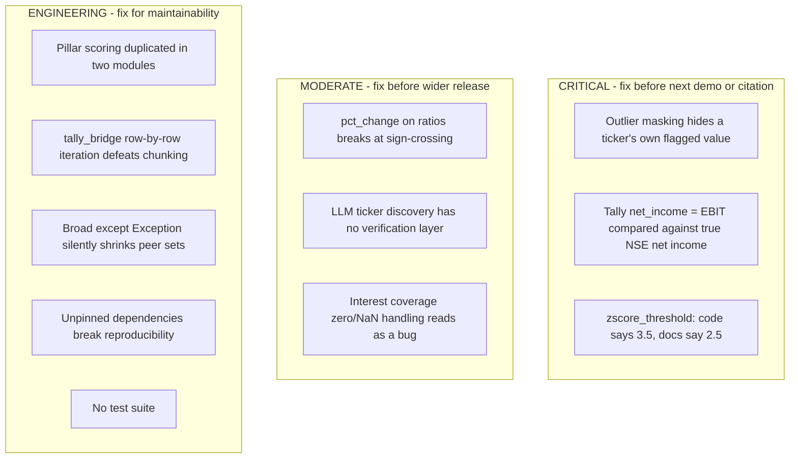

---

## 2. Finding F1 — Outlier Masking Hides a Ticker's Own Flagged Value

### 2.1 Current Logic

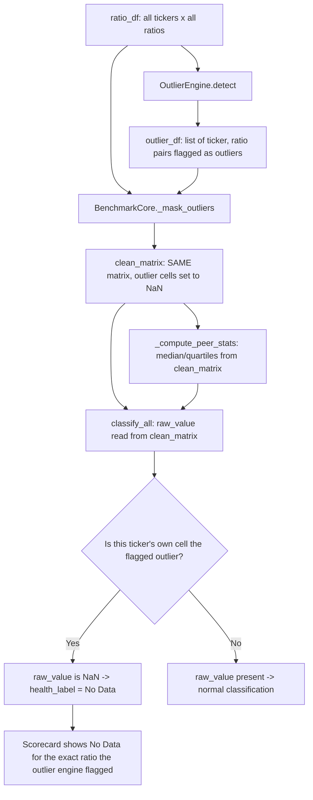

### 2.2 Why This Is Wrong

`clean_matrix` is built once and used for two different jobs that need different data:

1. Computing peer statistics (median, Q1, Q3) — outliers **should** be excluded here, since one distressed company should not skew the sector benchmark.
2. Reporting each ticker's own value back to the user — outliers **should not** be excluded here, because the outlier's own value is the entire point of running outlier detection.

Because both jobs read from the same masked matrix, a company whose debt-to-equity is flagged as an outlier will show `"No Data"` for debt-to-equity in its own scorecard row — the tool detects the anomaly and then hides it from the report.

### 2.3 Fixed Logic

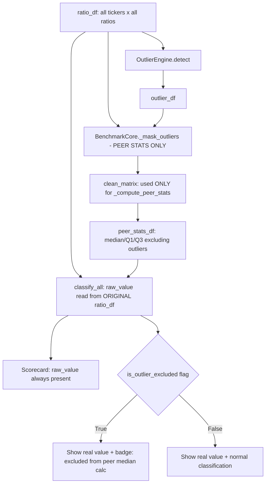

### 2.4 Fix

In `benchmark_core.py`:

```python
def run(self, ratio_df, outlier_df):
    clean = self._mask_outliers(ratio_df, outlier_df)      # for peer stats only
    peer_stats = self._compute_peer_stats(clean)
    # CHANGED: pass the ORIGINAL ratio_df for raw values, clean matrix stays
    # for peer_vals used in percentile computation.
    scorecard = self._build_ratio_scorecard(ratio_df, peer_stats, outlier_df, peer_pool=clean)
    ...
```

In `benchmark_classifier.classify_all`, split the two matrix arguments so `raw_val` always comes from the un-masked source, while `peer_vals` (used only to compute the percentile rank) comes from the masked pool:

```python
@classmethod
def classify_all(cls, raw_matrix, peer_pool_matrix, peer_stats_df, is_outlier_df=None):
    for ticker in raw_matrix.index:
        for ratio in raw_matrix.columns:
            raw_val = raw_matrix.at[ticker, ratio]        # never masked
            peer_vals = peer_pool_matrix[ratio].dropna()   # outliers excluded here only
            ...
```

Add one unit test that would have caught this on day one:

```python
def test_outlier_value_survives_in_own_scorecard():
    # ticker X has an extreme debt_to_equity flagged as an outlier
    result = BenchmarkCore().run(ratio_df, outlier_df)
    row = result.ratio_scorecard_df.query("ticker == 'X' and ratio == 'debt_to_equity'")
    assert not row["raw_value"].isna().any()
    assert row["is_outlier_excluded"].iloc[0] == True
```

---

## 3. Finding F2 — Tally `net_income` Is Actually EBIT

### 3.1 Current Logic

```mermaid
flowchart TD
    A[Tally Journal: Sales, COGS, Opex pillars only] --> B[ebit = revenue - cogs - opex]
    B --> C["net_income = ebit  # comment: No tax data available"]
    B --> D["ebitda = ebit  # no D&A add-back available"]
    C --> E[net_margin, roa, roe computed from ebit-as-net_income]
    D --> F[ebitda field mislabeled downstream]
    E --> G[ClientComparator.compare_client]
    G --> H[Benchmarked directly against NSE peer ratios]
    H --> I[NSE peers' net_margin/roa/roe use TRUE net income after tax+interest]
    I --> J[Client's percentile is systematically inflated - apples vs oranges]
```

### 3.2 Why This Is Wrong

A financial analyst comparing two `net_margin` numbers assumes both were computed the same way. Here, one side (Tally client) never subtracts interest or tax, while the other side (NSE peer set, sourced via `yfinance`) does. For any leveraged or meaningfully-taxed private company, this means:

- `net_margin`, `roa`, `roe` will all read **higher than they should**, because the deductions that shrink true net income are simply missing.
- The client will rank at a more favorable percentile than its actual economics justify — exactly the kind of error a financial reviewer would flag first, and exactly the error a benchmarking tool cannot afford to make silently.
- `ebitda` is also mislabeled: it is really EBIT (no depreciation/amortization add-back), so anything downstream reading `ebitda` gets a smaller number than the name promises.

### 3.3 Fixed Logic

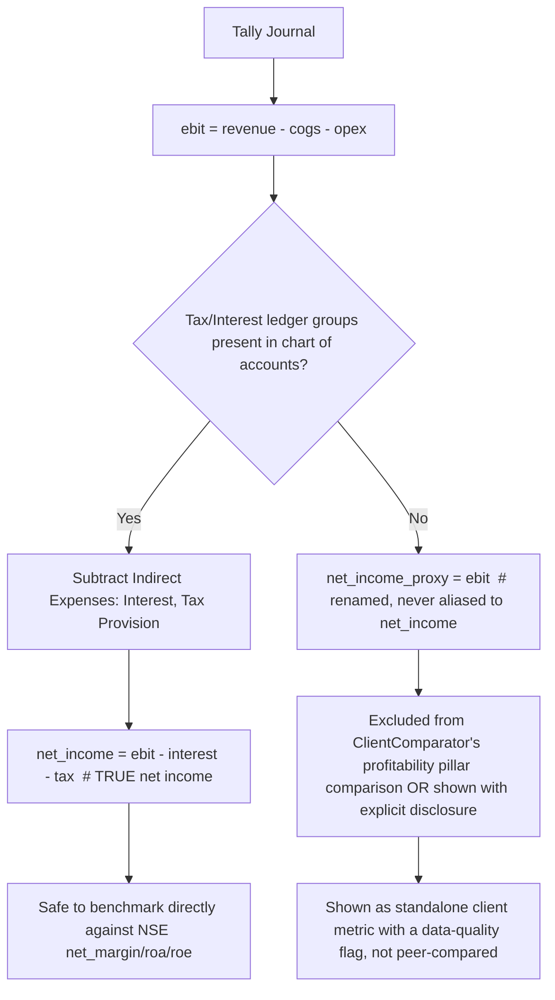

### 3.4 Fix

Minimum version — stop the silent mislabeling, in `tally_bridge.py`:

```python
# BEFORE
net_income = ebit
...
"ebitda": ebit,

# AFTER
net_income_proxy = ebit   # explicit name: this is EBIT, not net income
# Do NOT populate "net_income" or "ebitda" keys with this value.
# Downstream comparator must treat missing net_income/ebitda as "not comparable"
# rather than silently substituting the EBIT proxy.
```

Then in `client_comparator.py`, when a pillar's ratio depends on a key the Tally bridge could not truly compute (`net_margin`, `roa`, `roe`, anything keyed off true net income), tag that specific cell:

```python
if ratio in {"net_margin", "roa", "roe"} and source_is_tally_approximated:
    res["health_label"] = "Approximated (pre-tax/interest basis)"
    res["signal"] = "caution"
```

Better version — if the ledger master contains any `Indirect Expenses` sub-groups for interest or a `Duties & Taxes` provision line, wire those into `_compute_ratios()` so `net_income` becomes genuinely comparable:

```python
interest_expense = p.get("interest_expense", 0.0)
tax_provision    = p.get("tax_provision", 0.0)
net_income = ebit - interest_expense - tax_provision
```

This requires adding two new pillar mappings to `_GROUP_TO_PILLAR` (e.g. mapping an "Interest on Loans" ledger under `Indirect Expenses` to a new `interest_expense` pillar instead of the generic `opex` bucket it currently falls into).

---

## 4. Finding F3 — Outlier Threshold: Code vs. Documentation Mismatch

### 4.1 Current State

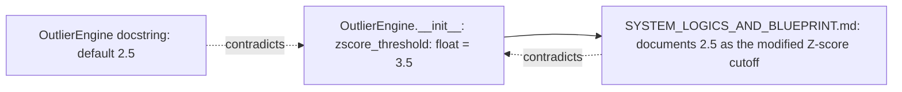

### 4.2 Why This Matters

Anyone tuning sensitivity, writing a paper citing this tool's methodology, or debugging "why didn't this obvious outlier get flagged" will read the docstring or the blueprint, assume 2.5, and be wrong. A detector at 3.5 is meaningfully more conservative than the literature-standard 2.5 (Iglewicz & Hoaglin) — this is a real methodological choice, not a typo to wave away either direction.

### 4.3 Fix

Pick one value deliberately and make all three sources agree:

```python
def __init__(
    self,
    iqr_multiplier: float = 1.5,
    zscore_threshold: float = 2.5,   # aligned with docstring and blueprint
    min_peers: int = 3,
) -> None:
```

If 3.5 was intentional (fewer false positives on a noisy small-N peer set), keep the code and instead update the docstring and `SYSTEM_LOGICS_AND_BLUEPRINT.md` to say so explicitly, with the reasoning recorded — not silently diverged.

---

## 5. Finding F4 — `pct_change` Breaks at Sign-Crossing

### 5.1 Current Logic

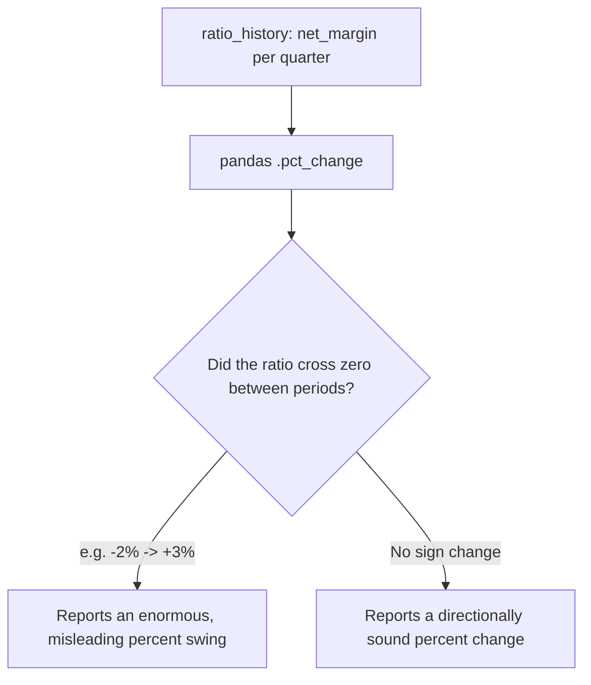

### 5.2 Fix

For ratios that are already expressed in percentage-point terms (margins, ROE, ROA, growth rates), report the change in **percentage points** (a simple subtraction) rather than a percent-of-a-percent:

```python
def compute_changes(self, ratio_history: pd.DataFrame) -> pd.DataFrame:
    pct_point_ratios = {
        "gross_margin", "operating_margin", "net_margin",
        "roe", "roa", "roce", "fcf_margin",
    }
    qoq = pd.DataFrame(index=ratio_history.index)
    for col in ratio_history.columns:
        if col in pct_point_ratios:
            qoq[f"{col}_qoq_pp"] = ratio_history[col].diff(1)          # percentage-point delta
        else:
            qoq[f"{col}_qoq"] = ratio_history[col].pct_change(1) * 100  # true multiples (e.g. asset_turnover)
    return qoq
```

Flag sign-crossing explicitly rather than silently emitting the distorted number, for any ratio still using `pct_change`:

```python
sign_flip = (ratio_history[col].shift(1) < 0) & (ratio_history[col] >= 0)
qoq.loc[sign_flip, f"{col}_qoq"] = np.nan  # or a "sign_flip" marker column
```

---

## 6. Finding F5 — LLM-Sourced Ticker Discovery Has No Verification Layer

### 6.1 Current Logic

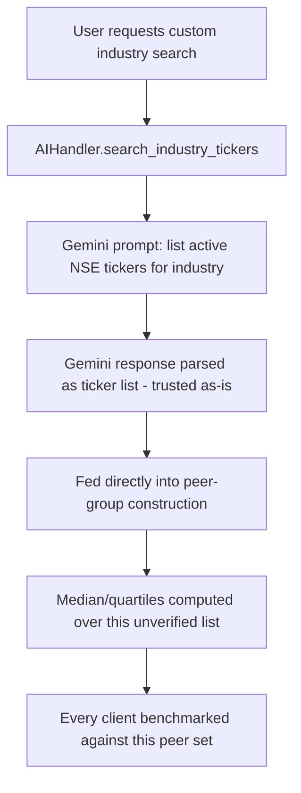

### 6.2 Why This Is Risky

LLMs hallucinate tickers and include delisted, merged, or renamed entities despite explicit prompt instructions to exclude them. Since this list becomes the denominator for every statistic a client is measured against, an unverified ticker slipping in silently corrupts every downstream benchmark for that run.

### 6.3 Fixed Logic

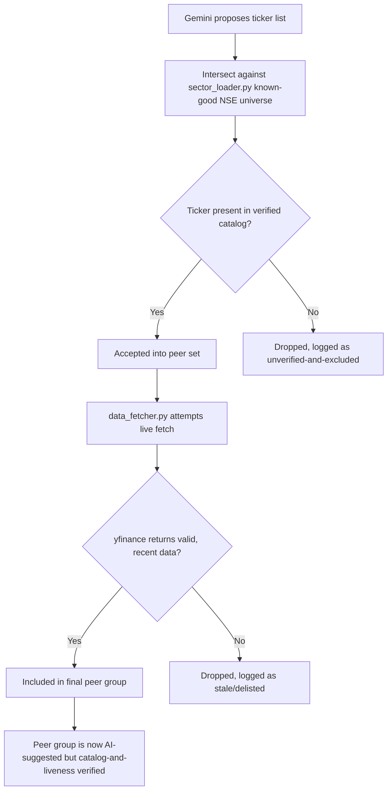

### 6.4 Fix

```python
def search_industry_tickers(self, query: str, market: str = "NSE India") -> List[str]:
    raw_candidates = self._ask_gemini(query, market)          # existing logic
    verified_universe = SectorLoader().all_known_tickers()     # existing static catalog
    verified = [t for t in raw_candidates if t in verified_universe]
    dropped = set(raw_candidates) - set(verified)
    if dropped:
        logger.warning("AI suggested %d tickers not in verified NSE catalog, excluded: %s",
                        len(dropped), sorted(dropped))
    return verified
```

---

## 7. Finding F6 — Interest Coverage Zero/NaN Handling Reads as a Bug

### 7.1 Current Code

```python
"interest_coverage": sd(operating_income, abs(interest_expense) if interest_expense else np.nan),
```

`bool(np.nan)` evaluates `True` in Python, so this line only "works" by coincidence: a genuinely zero interest expense and a missing (NaN) interest expense are both routed to the same `np.nan` denominator, relying on `safe_divide`'s own NaN guard to produce the final `NaN`. It happens to be correct, but nobody reading it next will trust that it's correct.

### 7.2 Fix

```python
if pd.isna(interest_expense):
    ratios["interest_coverage"] = np.nan                       # data missing
elif interest_expense == 0:
    ratios["interest_coverage"] = np.inf                       # no debt-service burden
else:
    ratios["interest_coverage"] = sd(operating_income, abs(interest_expense))
```

Downstream, `OutlierEngine` and `BenchmarkClassifier` should treat `np.inf` as "excellent, off the top of the scale" rather than crashing on percentile computation — `stats.percentileofscore` handles `inf` correctly, but `_severity()`'s IQR-width math should be checked against an `inf` input in a unit test.

---

## 8. Finding F7 — Pillar Scoring Duplicated Across Two Modules

### 8.1 Current State

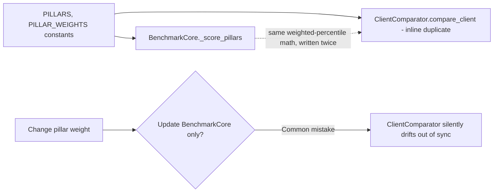

### 8.2 Fix

Extract the shared logic into a pure function both call:

```python
# in benchmark_core.py
def score_pillars(pct_df: pd.DataFrame, pillars: dict) -> pd.DataFrame:
    """Pure function: percentile matrix -> pillar scores. No class state."""
    ...

def rank_categorize(pillar_df: pd.DataFrame, weights: dict) -> pd.DataFrame:
    ...
```

```python
# in client_comparator.py
from modules.benchmark_core import score_pillars, rank_categorize

pillar_summary = score_pillars(pct_df, PILLARS)
pillar_summary = rank_categorize(pillar_summary, PILLAR_WEIGHTS)
```

One implementation, two call sites — a pillar-weight change now only needs to happen once.

---

## 9. Finding F8 — `tally_bridge.py` Row-by-Row Iteration Defeats Its Own Chunking

### 9.1 Current Logic

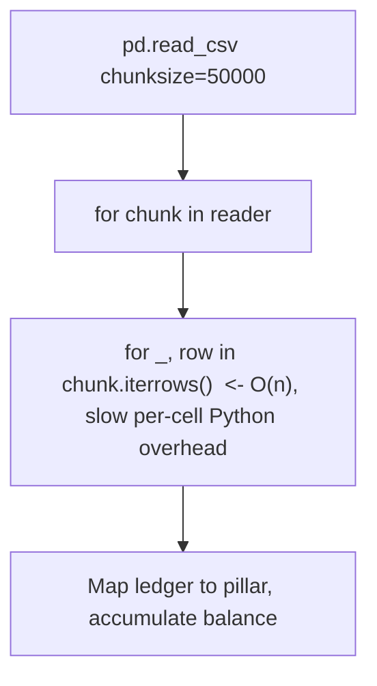

### 9.2 Fix — Vectorized

```python
def _aggregate_journal(self, ledger_map: Dict[str, str]) -> Dict[str, float]:
    pillars = {p: 0.0 for p in set(_GROUP_TO_PILLAR.values()) if p != "EXCLUDE"}
    for chunk in pd.read_csv(self.jv_path, encoding="latin1", chunksize=self.chunk_size):
        chunk["pillar"] = chunk["PARTICULARS"].str.strip().map(ledger_map).fillna("EXCLUDE")
        chunk = chunk[chunk["pillar"] != "EXCLUDE"].copy()
        chunk["DEBIT"] = pd.to_numeric(chunk["DEBIT"], errors="coerce").fillna(0.0)
        chunk["CREDIT"] = pd.to_numeric(chunk["CREDIT"], errors="coerce").fillna(0.0)

        credit_mask = chunk["pillar"].isin(_CREDIT_NATURE)
        chunk["balance"] = np.where(
            credit_mask,
            chunk["CREDIT"] - chunk["DEBIT"],
            chunk["DEBIT"] - chunk["CREDIT"],
        )
        grouped = chunk.groupby("pillar")["balance"].sum()
        for pillar, val in grouped.items():
            pillars[pillar] += val
    return pillars
```

Same output, no per-row Python loop — this is the standard pandas vectorization pattern and will scale to the large exports the chunking was designed for.

---

## 10. Finding F9 — Broad Exception Handling Silently Shrinks Peer Sets

### 10.1 Current Logic

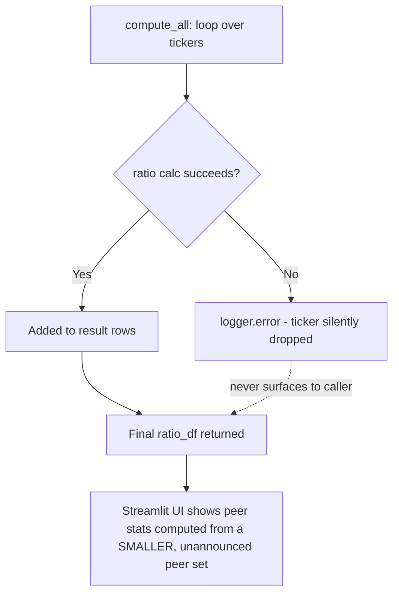

### 10.2 Fix

```python
def compute_all(self, parsed, market_info=None):
    rows, failed = {}, []
    for ticker, stmts in parsed.items():
        try:
            rows[ticker] = self._compute_ticker_ratios(ticker, stmts, market_info)
        except Exception as exc:
            logger.error("Ratio calc failed for %s: %s", ticker, exc)
            failed.append({"ticker": ticker, "reason": str(exc)})

    df = pd.DataFrame(rows).T if rows else pd.DataFrame()
    df.attrs["failed_tickers"] = failed          # surfaced via DataFrame.attrs
    return df
```

```python
# app.py Streamlit layer
if not ratio_df.attrs.get("failed_tickers", []):
    st.caption(f"{len(ratio_df)}/{len(ratio_df) + 0} peers included.")
else:
    n_failed = len(ratio_df.attrs["failed_tickers"])
    st.warning(f"{n_failed} peer(s) excluded from benchmark due to data errors — see details.")
```

---

## 11. Finding F10 — Unpinned Dependencies

### 11.1 Problem

Every line in `requirements.txt` uses `>=`. For a tool whose stated goal is academic citation, a `pandas`/`scikit-learn` minor version bump between when a result is computed and when someone else reproduces it can silently change `pct_change` defaults or `IsolationForest` internals.

### 11.2 Fix

```
pandas==2.2.2
numpy==1.26.4
scipy==1.13.0
scikit-learn==1.4.2
streamlit==1.35.0
...
```

Generate with `pip freeze > requirements.lock.txt` from a known-good environment, and cite that lockfile's commit hash in any published methodology.

---

## 12. Finding F11 — No Test Suite

### 12.1 Minimum Viable Coverage

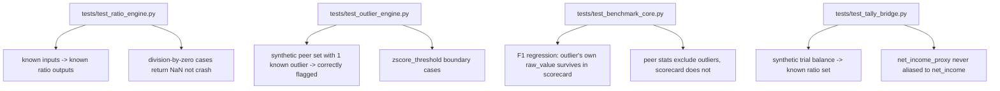

### 12.2 Fix

```
pip install pytest pytest-cov --break-system-packages
```

Add to `requirements.txt`, add a `tests/` directory mirroring `modules/`, and wire a GitHub Action (`.github/workflows/tests.yml`) to run `pytest --cov=modules` on every push — this repo already has Actions available per its GitHub navigation.

---

## 13. Remediation Roadmap

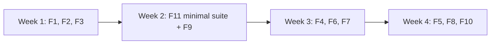

| Priority | Finding | Effort | Risk if unfixed |
|---|---|---|---|
| P0 | F1 — outlier masking hides own value | Small | Core product claim undermined |
| P0 | F2 — EBIT mislabeled as net income | Medium | Invalid benchmark comparisons, credibility risk with reviewers |
| P0 | F3 — threshold doc mismatch | Trivial | Confuses anyone tuning or citing the method |
| P1 | F11 — no tests | Medium | Regressions like F1 ship undetected |
| P1 | F9 — silent peer-set shrinkage | Small | Misleading "peer group" size |
| P2 | F4 — pct_change sign-crossing | Small | Misleading QoQ/YoY numbers in edge cases |
| P2 | F6 — interest coverage readability | Trivial | Maintainability, not correctness |
| P2 | F7 — duplicated pillar logic | Medium | Future drift between client and peer scoring |
| P3 | F5 — unverified AI ticker discovery | Medium | Bad peer data if this feature is used |
| P3 | F8 — iterrows performance | Medium | Slow on large Tally exports |
| P3 | F10 — unpinned dependencies | Trivial | Reproducibility risk for citations |
