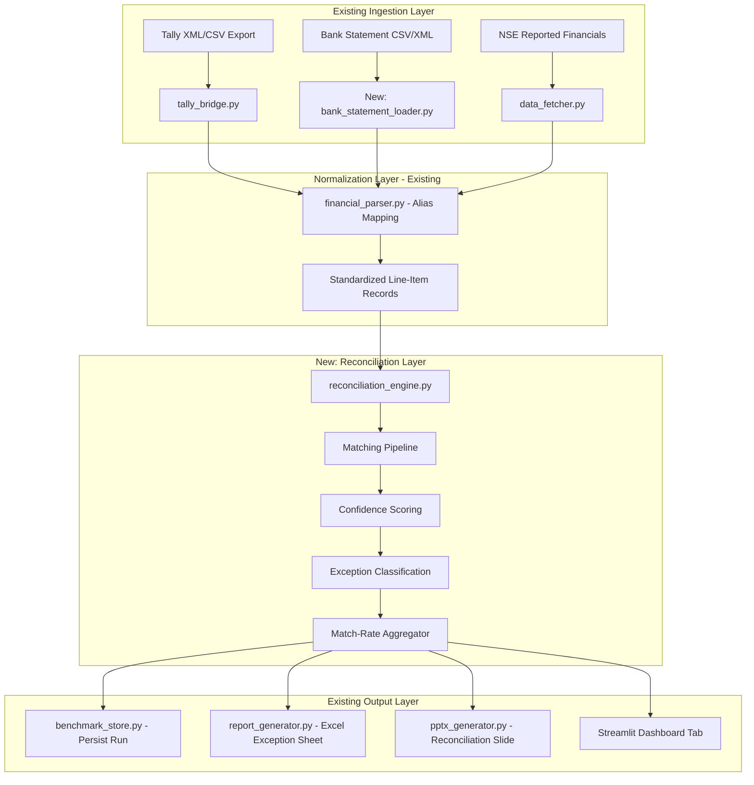
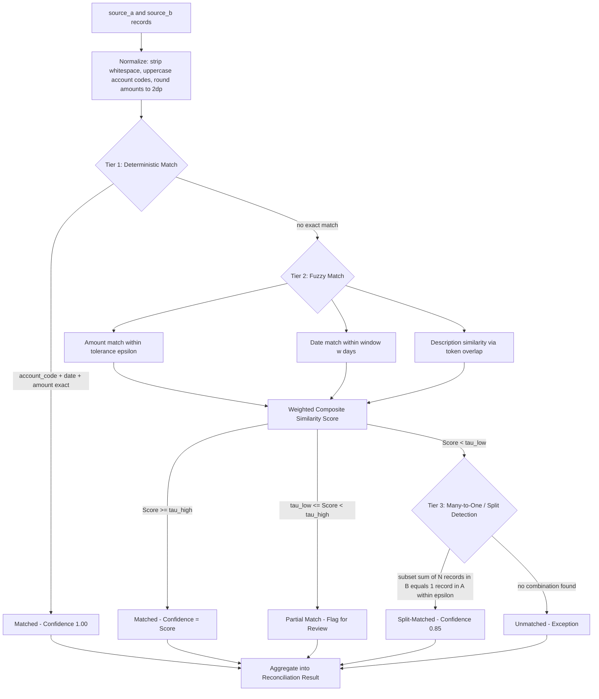
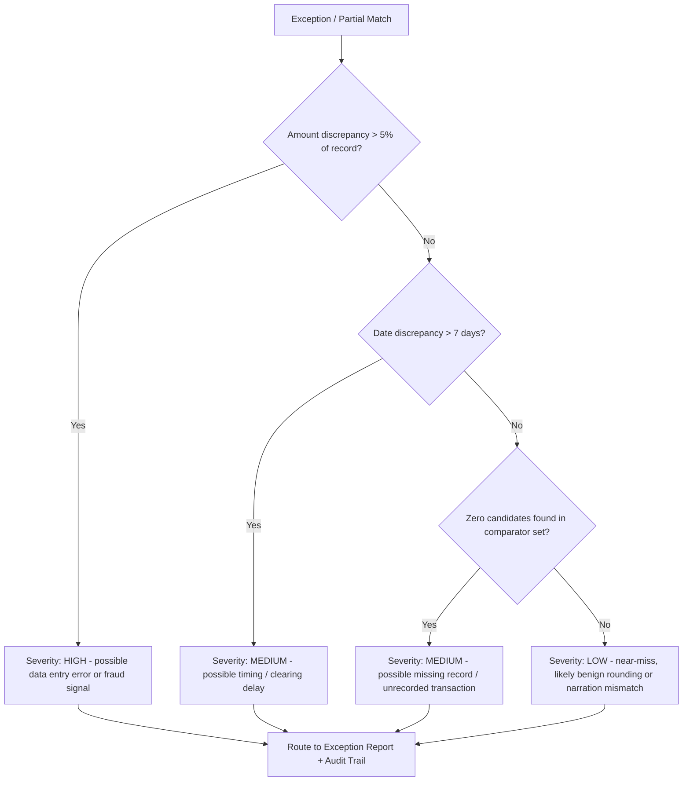

# Reconciliation Engine: System Blueprint and Algorithmic Specification

## 0. Purpose

This document specifies `reconciliation_engine.py`, a new analytical module for FinMetrics Suite that closes a single finance-ops loop: matching two independently sourced financial record sets (e.g. Tally trial balance vs. bank statement, or Tally vs. NSE-reported subsidiary financials) and producing a measured match rate with a fully auditable exception list. It is designed to satisfy a "Multi-source reconciliation" deliverable — throughput, measured accuracy, and an honest exception list on a batch of 50+ records, with no cherry-picking.

The module is additive. It consumes the existing `financial_parser.py` output schema and the `tally_bridge.py` normalization layer, and it writes into the existing `benchmark_store.py` persistence layer and `report_generator.py` / `pptx_generator.py` output layers. No existing module is modified.

---

## 1. System Position



Only one new ingestion component is required: `bank_statement_loader.py`, a thin CSV/XML reader that outputs the same `StandardizedRecord` schema already used elsewhere in the codebase, so the reconciliation engine never needs to know which side of the pair a record came from.

---

## 2. Data Model

Every input record is coerced into a common schema before matching. This is the contract the engine trusts.

```
StandardizedRecord
├── record_id        : str    # source-native ID, preserved for audit trail
├── source            : enum  # {TALLY, BANK, NSE, CLIENT}
├── date              : date
├── account_label     : str   # post-alias-mapping canonical label
├── account_code      : str | None
├── amount            : Decimal
├── direction         : enum  # {DEBIT, CREDIT}
├── description        : str
└── raw_ref           : dict  # original row, retained for traceability
```

The engine operates on two `List[StandardizedRecord]` inputs: `source_a` (system of record, e.g. Tally) and `source_b` (comparator, e.g. bank statement or NSE filing).

---

## 3. Matching Pipeline

Reconciliation is treated as a three-tier cascade. Each tier only receives records the prior tier failed to resolve, so cost-expensive matching is never wasted on records already settled deterministically.



### 3.1 Tier 1 — Deterministic Match

Exact match on the tuple `(account_code, date, amount)`. This is a hash-join, O(n) after sorting, and should resolve the majority of records in a clean batch. Confidence is fixed at 1.00 since there is no ambiguity.

### 3.2 Tier 2 — Fuzzy Match

For unresolved records, candidates are generated by relaxing constraints:

- **Amount tolerance**: `|amount_a - amount_b| <= epsilon`, where epsilon defaults to the greater of ₹1 or 0.1% of `amount_a`, to absorb rounding and bank charges.
- **Date window**: `|date_a - date_b| <= w` days, where `w` defaults to 3 (covers clearing delays).
- **Description similarity**: token-set overlap (Jaccard index) between `description_a` and `description_b`, since free-text narrations rarely match verbatim across systems.

$$
\text{Jaccard}(d_a, d_b) = \frac{|T(d_a) \cap T(d_b)|}{|T(d_a) \cup T(d_b)|}
$$

where $T(d)$ is the token set of description $d$ after lowercasing and stopword removal.

Composite similarity score:

$$
S = w_1 \cdot \mathbb{1}\!\left[|amount_a - amount_b| \le \epsilon\right] + w_2 \cdot \max\!\left(0,\, 1 - \frac{|date_a - date_b|}{w}\right) + w_3 \cdot \text{Jaccard}(d_a, d_b)
$$

Default weights: $w_1 = 0.5$, $w_2 = 0.3$, $w_3 = 0.2$ (amount agreement is the strongest signal; description is the weakest and noisiest). Weights live in a config file, not hardcoded, per the codebase's existing pattern of centralizing thresholds.

When multiple candidates in `source_b` clear the same threshold against one record in `source_a`, the engine performs **bipartite optimal assignment** (Hungarian algorithm, already reachable via `scipy.optimize.linear_sum_assignment`, which is already a project dependency) rather than greedily taking the first match — this avoids double-counting a single bank line against two ledger entries.

Thresholds: `tau_high = 0.85`, `tau_low = 0.55` (configurable). Above `tau_high` the match is accepted; between the two it is queued as a **partial match** for human review rather than silently auto-resolved — this is the mechanism that prevents inflated match-rate numbers.

### 3.3 Tier 3 — Split / Many-to-One Detection

Handles the common case where one ledger entry corresponds to several bank lines (e.g. a single invoice paid in two instalments) or vice versa. This is a subset-sum search bounded to small combinations (up to `k=4` records) to keep it tractable:

$$
\exists\, S \subseteq B : \left| \sum_{b \in S} amount_b - amount_a \right| \le \epsilon, \quad |S| \le k
$$

Because subset-sum is combinatorially expensive at scale, the search is restricted to candidate records already within the Tier 2 date window, keeping the search space small (typically under 20 candidates per unresolved record).

### 3.4 Unresolved

Anything that clears no tier is logged as an **exception** with the specific reason code (`NO_AMOUNT_CANDIDATE`, `NO_DATE_CANDIDATE`, `BELOW_THRESHOLD`, `AMBIGUOUS_MULTI_MATCH`) — never a bare "unmatched" label. The reason code is what makes the exception list debuggable rather than a dead end.

---

## 4. Exception Classification

Every non-Tier-1 outcome is routed through a classifier that assigns a severity, so the output report can be triaged rather than read as an undifferentiated list.



This reuses the same severity vocabulary (`HIGH / MEDIUM / LOW`) already established by `outlier_engine.py`, so a user reading both reports doesn't have to learn a second taxonomy.

---

## 5. Match-Rate and Batch Metrics

Reported at the end of every run — this is the number the track's bar explicitly asks for, so it must be computed transparently and shown alongside its components, not just as a single headline percentage.

$$
\text{Match Rate} = \frac{N_{\text{Tier1}} + N_{\text{Tier2}} + N_{\text{Tier3}}}{N_{\text{total}}}
$$

$$
\text{Auto-Resolved Rate} = \frac{N_{\text{Tier1}} + N_{\text{Tier2 (}S \ge \tau_{high}\text{)}}}{N_{\text{total}}}
$$

$$
\text{Review-Required Rate} = \frac{N_{\text{Partial Matches}}}{N_{\text{total}}}
$$

$$
\text{Exception Rate} = \frac{N_{\text{Unresolved}}}{N_{\text{total}}} = 1 - \text{Match Rate}
$$

The report always shows all four numbers together, plus a confidence-score histogram, so a 95% "match rate" that is mostly low-confidence Tier 2 matches cannot masquerade as a clean reconciliation — this is the concrete answer to "one cherry-picked match proves nothing."

---

## 6. Output Artifacts

1. **`reconciliation_result.json`** — machine-readable: every record's outcome, tier, confidence, and reason code. This is the audit trail.
2. **Excel exception sheet** (via existing `report_generator.py`) — one row per unresolved/partial record, sorted by severity, with both source rows shown side by side for human review.
3. **PPTX reconciliation slide** (via existing `pptx_generator.py` / `pptx_slides.py`) — headline match rate, the four-metric breakdown above, and a confidence histogram, styled with the existing `pptx_design_tokens.py` palette.
4. **Streamlit tab** — interactive filter by severity/tier, drill into any single exception's two source rows and its computed score components.

---

## 7. New Module Files

| File | Responsibility |
|---|---|
| `modules/reconciliation_engine.py` | Core matching cascade (Tiers 1–3), orchestration |
| `modules/bank_statement_loader.py` | Parses bank CSV/XML into `StandardizedRecord` |
| `modules/reconciliation_config.py` | Centralized thresholds: `epsilon`, `w` (date window), `tau_high`, `tau_low`, tier weights — no magic numbers in the engine itself |
| `modules/reconciliation_report.py` | Formats results for Excel/PPTX/JSON output, reusing `report_generator.py` and `pptx_generator.py` primitives |

---

## 8. Validation Plan

1. Generate a synthetic batch of 60 record pairs: ~40 exact matches, ~10 fuzzy matches (rounding/date drift), ~5 split transactions, ~5 deliberately unmatched (missing/erroneous records).
2. Run the engine; report the four metrics from Section 5 against the **known ground truth**, not just the engine's self-reported numbers — precision and recall against the synthetic labels, the same honesty standard the outlier engine already applies to its own severity classification.
3. Publish the confusion matrix (true match / false match / true exception / false exception) in the demo — this is what makes the "measured accuracy" claim verifiable rather than asserted.

---

## 9. Track Alignment Checklist

- [x] Closes one finance-ops loop (ledger-to-bank or ledger-to-filing reconciliation)
- [x] Runs on a 50+ record synthetic batch
- [x] Reports match rate as a transparent, decomposed metric
- [x] Produces an honest, severity-ranked exception list — no cherry-picking
- [x] Full audit trail via `reconciliation_result.json` and side-by-side exception rows
